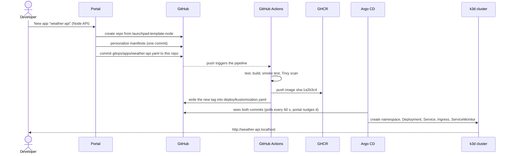
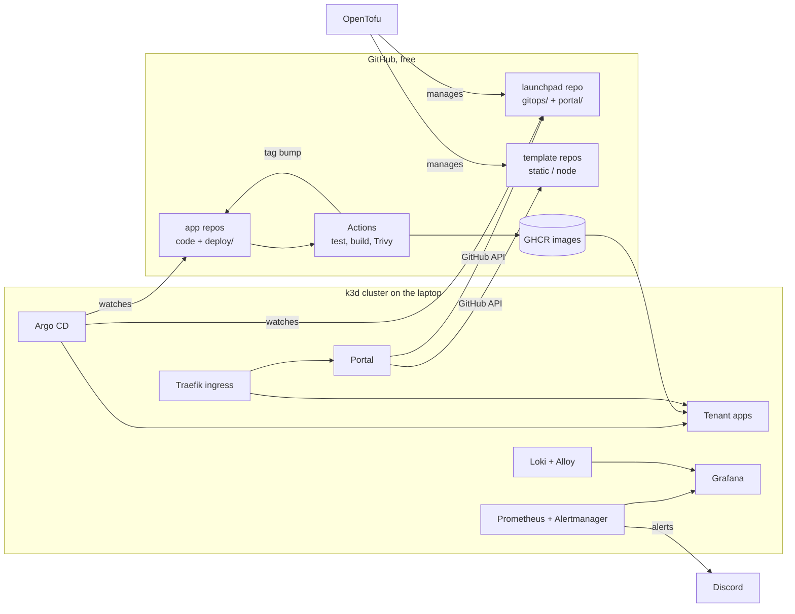
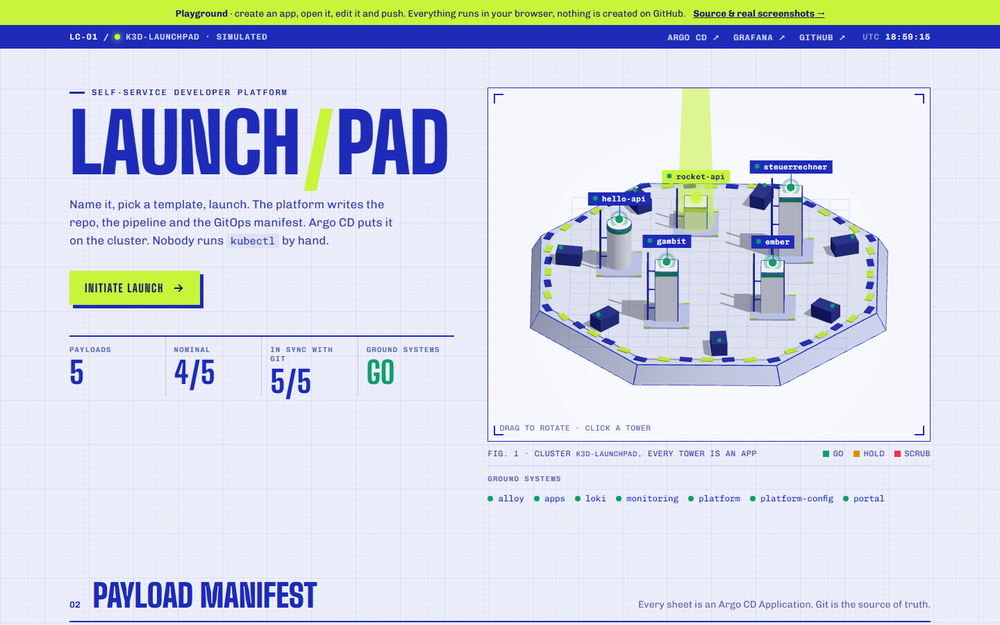
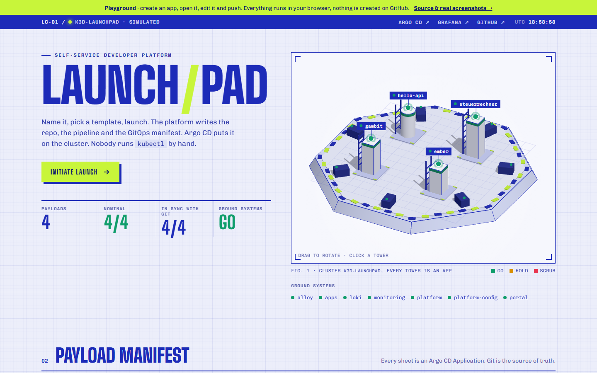
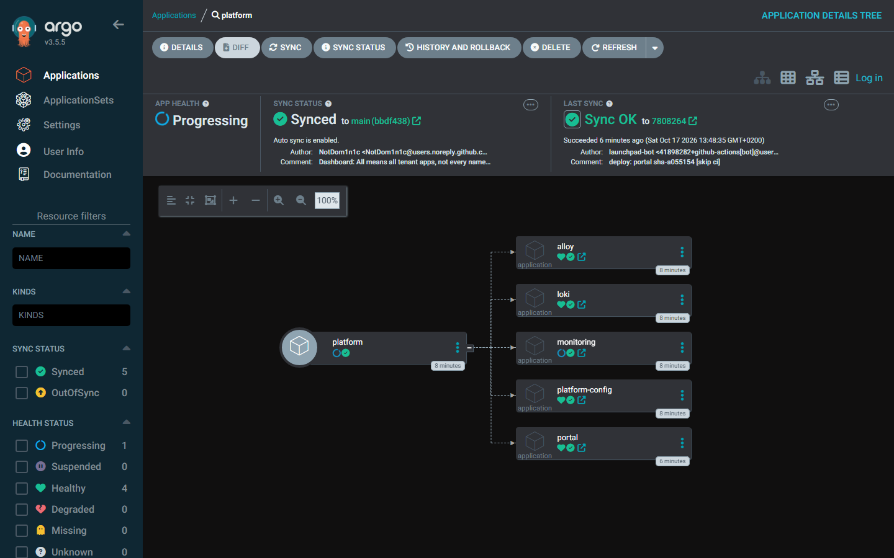
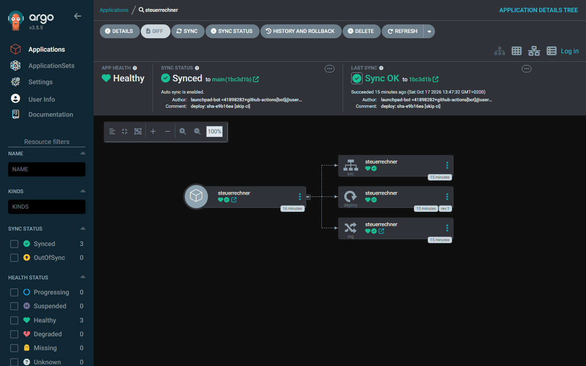
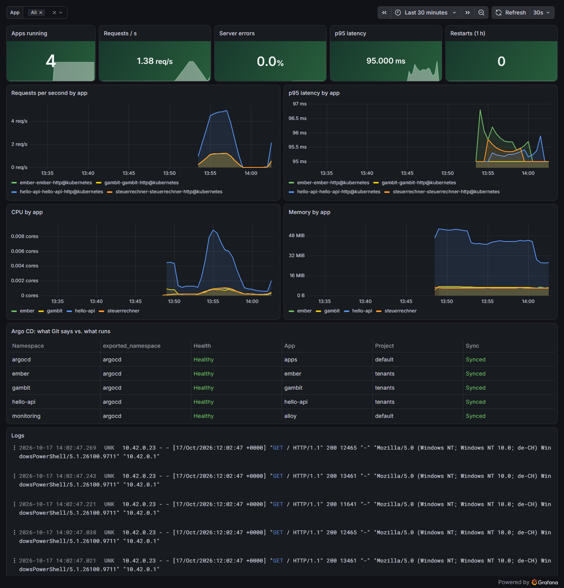

# LAUNCHPAD

**A self-service developer platform on Kubernetes.** Click *New app*, pick a template, and a few minutes later the app has its own GitHub repository, a CI pipeline with a security scan, a container image, a GitOps deployment, a URL, metrics, logs and alerts. Nobody runs `kubectl` by hand.

[**Playground**](https://notdom1n1c.github.io/launchpad/): the real portal UI on a simulated cluster in your browser. Create an app, open it, read its generated files, edit it and push, and watch the pipeline and the rollout. Static sites render from the real template files, Node APIs run the real template code, and broken code fails the tests just like in CI. Nothing is created on GitHub.


Built by Dominic Aebersold (Informatiker EFZ Plattformentwicklung, 2nd year) as a portfolio project. Everything runs on a laptop or on free GitHub services, so the whole platform costs **0 CHF**.

---

## What happens when you press *New app*



The portal shows each of those five steps live, with links to the repository, the pipeline run and Argo CD.

## Architecture



| Layer | Tool | Where |
|---|---|---|
| Cluster as code | k3d (k3s 1.36), single node | [`cluster/k3d.yaml`](cluster/k3d.yaml) |
| GitHub as code | OpenTofu + GitHub provider | [`infra/github/`](infra/github) |
| GitOps | Argo CD 3.5, app-of-apps, auto-sync, self-heal, prune | [`bootstrap/`](bootstrap), [`gitops/`](gitops) |
| Guard rails | `tenants` AppProject: own repos only, no platform namespaces, no RBAC objects | [`gitops/platform-config/tenants-project.yaml`](gitops/platform-config/tenants-project.yaml) |
| CI/CD | GitHub Actions: test, build, container smoke test, Trivy, GHCR, GitOps tag bump | [`scripts/pipeline.tmpl.yml`](scripts/pipeline.tmpl.yml) |
| Ingress | Traefik (built into k3s), `*.localhost` hosts | per app `deploy/ingress.yaml` |
| Metrics + alerts | kube-prometheus-stack, Traefik request metrics, Argo CD metrics | [`gitops/platform/monitoring.yaml`](gitops/platform/monitoring.yaml) |
| Logs | Loki (single binary) + Grafana Alloy | [`gitops/platform/loki.yaml`](gitops/platform/loki.yaml), [`alloy.yaml`](gitops/platform/alloy.yaml) |
| Dashboard | "LAUNCHPAD / Apps": requests, errors, p95, CPU, memory, Argo state, logs | [`gitops/platform-config/dashboards/`](gitops/platform-config/dashboards) |
| Portal | Node 24, no dependencies, least-privilege RBAC | [`portal/`](portal) |
| End-to-end test | whole platform built from scratch on a GitHub runner, every push | [`.github/workflows/e2e.yml`](.github/workflows/e2e.yml) |

### Apps on the platform

| App | Template | Repo |
|---|---|---|
| Steuerrechner (Swiss tax calculator, 23 regression tests in headless Chrome) | static site | [NotDom1n1c/steuerrechner](https://github.com/NotDom1n1c/steuerrechner) |
| GAMBIT (chess platform with its own engine) | static site | [NotDom1n1c/gambit](https://github.com/NotDom1n1c/gambit) |
| Ember (Canvas image editor) | static site | [NotDom1n1c/ember](https://github.com/NotDom1n1c/ember) |
| + anything created with *New app* | static site / Node API | |

## Run it yourself

Windows 11 with WSL. Needs about 5 GB RAM while it runs and nothing when it is stopped.

```powershell
.\launchpad.ps1 setup    # once: WSL distro "launchpad" with Docker Engine, k3d, kubectl, helm
.\launchpad.ps1 up       # cluster + Argo CD, then everything else comes from Git (about 6 min)
.\launchpad.ps1 open     # http://launchpad.localhost
```

| URL | What |
|---|---|
| http://launchpad.localhost | the portal |
| http://argocd.localhost | Argo CD (read-only without login) |
| http://grafana.localhost | Grafana, opens on the LAUNCHPAD dashboard |
| http://steuerrechner.localhost, http://gambit.localhost, http://ember.localhost | the apps |

| Command | |
|---|---|
| `.\launchpad.ps1 status` | every Argo CD app with sync and health |
| `.\launchpad.ps1 smoke` | end-to-end checks (ingress, metrics, logs, alert rules) |
| `.\launchpad.ps1 chaos gambit` | break an app on purpose and watch Argo CD heal it |
| `.\launchpad.ps1 stop` / `start` | pause and give all RAM back / resume in a minute |
| `.\launchpad.ps1 down` | delete the cluster (Git keeps everything, `up` rebuilds it) |
| `.\launchpad.ps1 remove` | delete the cluster and the WSL distro |

Alerts go to Discord if you set `$env:DISCORD_WEBHOOK` before `up`. On Linux or macOS, run `scripts/up.sh` directly.

## Design decisions

- **Git is the only way in.** The portal never deploys anything itself. It writes to Git, and Argo CD applies it. So every change is reviewable and revertible, and `git revert` is the rollback.
- **The pipeline commits the image tag.** CI writes `sha-<commit>` into `deploy/kustomization.yaml`. You can always see which commit runs where, and nothing uses `:latest` in production.
- **One template, one golden path.** Every app gets the same Dockerfile shape, probes, resource limits, non-root user, read-only root filesystem, dropped capabilities and seccomp profile. Teams get a secure default without thinking about it.
- **Least privilege for the portal.** Its ServiceAccount can only read Argo CD Applications and Deployments and annotate Applications to refresh. It cannot create or change workloads. The GitHub token lives in a Kubernetes secret, never in Git.
- **Tenants are fenced in.** The `tenants` AppProject only accepts repos from this account, blocks `kube-system`, `argocd`, `monitoring` and `launchpad`, and only allows Deployments, Services, Ingresses, ConfigMaps, ServiceMonitors and HPAs.
- **Supply chain.** Third-party GitHub Actions are pinned to commit SHAs. Images are scanned with Trivy, and fixable CRITICAL findings block the release.
- **Tested like a product.** The `e2e` workflow builds the complete platform on a fresh runner, runs the smoke tests and a self-healing test, and repeats that every Monday.
- **Lean enough for a laptop.** Every component has requests and limits, Prometheus keeps 2 days, Loki 3 days, and WSL is capped at 6 GB.

## Repository layout

```
cluster/          k3d cluster definition
bootstrap/        Argo CD values + the two root applications (the only things applied by hand)
gitops/platform/  monitoring, Loki, Alloy, policies, portal (Argo CD Applications)
gitops/platform-config/  AppProject, Traefik metrics, alert rules, Grafana dashboard
gitops/apps/      one Application per tenant app (the portal writes here)
portal/           portal source, tests, Dockerfile and its own deploy/ manifests
templates/        content of the template repositories
infra/github/     OpenTofu: template repos, repo settings, GitHub Pages
scripts/          up / down / smoke test / chaos / WSL setup / shared pipeline
launchpad.ps1     Windows entry point
```

## Screenshots

**Portal** (from the playground, same UI as on the cluster): Fig. 1 is the cluster in three.js. Every app is a tower on the launch deck, its beacon shows GO / HOLD / SCRUB, and a new app rises out of the deck with each launch step (here `rocket-api`, with its launch beam).





Argo CD and Grafana below are from the real cluster on my laptop.

**Argo CD**: the `platform` app-of-apps, synced to the latest commit



**Argo CD**: one tenant app, deployed from its own `deploy/` folder. The last sync is the pipeline's tag commit.



**Grafana**: the LAUNCHPAD dashboard with requests, p95 latency, CPU, memory, Argo CD state and logs from Loki



## License

MIT
